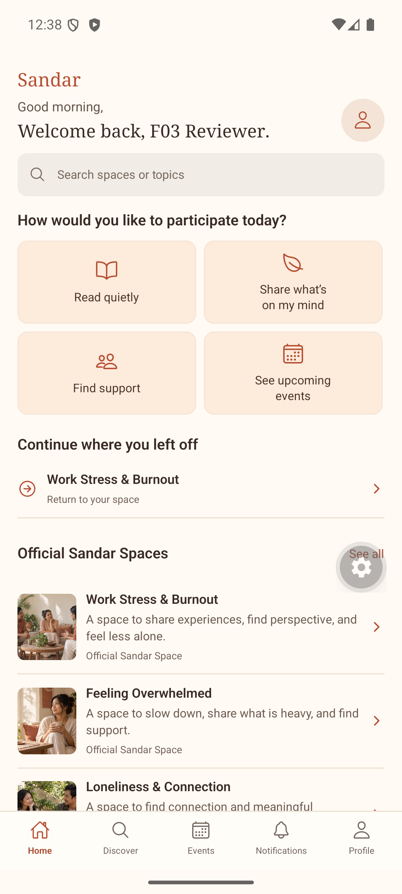
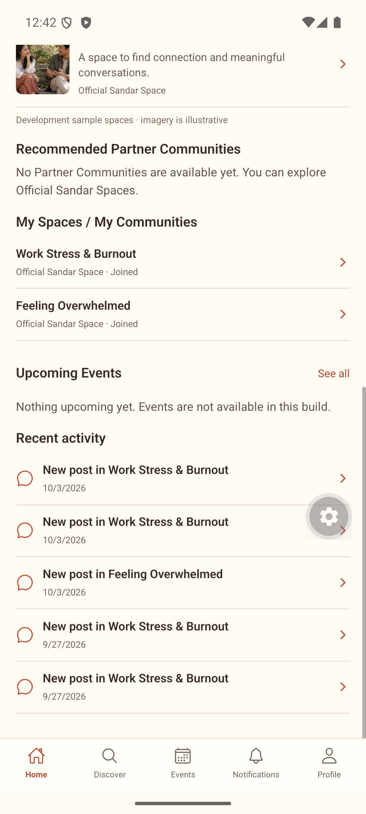
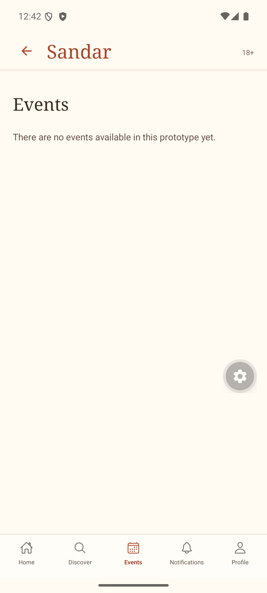
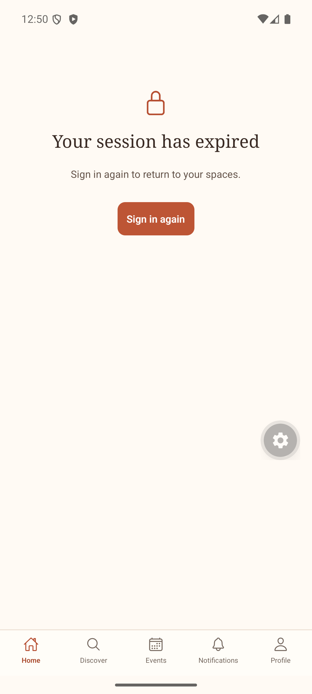

# F05 Member Home integration and refinement — 2026-10-04

## Assessment

| Area | Before | Final |
|---|---|---|
| Greeting, authenticated tabs | MATCH, missing visible Sandar name | MATCH; brand restored, Home active |
| Search | NEEDS UPDATE: promised event search unsupported by gateway | MATCH: spaces/topics gateway only |
| Participation shortcuts | MATCH behavior; label alignment needed | MATCH: Read quietly, Share, Find support, Events |
| Continue placement | NEEDS UPDATE: below Events | MATCH: after shortcuts, before Official Spaces |
| Official cards | NEEDS UPDATE: identity label absent | MATCH: Official Sandar Space, no fabricated counts |
| Partners | NEEDS UPDATE: empty copy implied growth | MATCH: honest absence, no fake supply |
| My Spaces | MATCH | MATCH, server-joined only |
| Events | Supported empty capability | MATCH within current scope; disabled API capability, no event inventory |
| Recent Activity | MATCH | MATCH: accessible joined-space post metadata only |
| Loading/partial/error/retry/empty states | MATCH | MATCH in rendered tests |
| Expiry heading | NEEDS UPDATE: clipped last word on Android | MATCH after width/line-height fix |
| Preference ranking | MISSING, optional recommendation capability | Deferred; no claim of personalized ranking |

## Changes

Only apps/mobile/src/home/MemberHomeScreen.tsx, apps/mobile/src/home/model.ts, tests/home-screen.test.jsx, tests/home.integration.test.ts, and this QA folder changed for F05. No backend production source, migrations, auth/routing, F03/F04, dependencies, or F06 implementation changed.

Moved Continue above supply sections; restored Sandar and Official identity labels; aligned Find support; constrained search copy to existing space gateway; corrected Partner/Events capability copy; reduced greeting, thumbnail and section spacing; fixed clipped session-expiry heading with explicit available width and line height. Existing colors, serif/sans fonts, icons, imagery and active navigation preserved. Text scaling remains enabled.

## Data sources and integration

- Greeting: users/member_profiles through authenticated GET /v1/home; hour from device clock.
- Official Spaces: existing GET /v1/spaces and support_spaces; F04 handles profile/feed/composer, membership and post access.
- My Spaces: space_memberships JOINED plus active support_spaces; intersected with latest client space permissions. Partner joined records derive from the Home projection.
- Continue: member_home_context, persisted through POST /v1/home/context from F04. Server removes invalid context on Home refresh. Deleted posts cascade; removed/blocked/restricted/left destinations are ignored/removed. Click revalidates Space and post through F04. Central destination resolver remains unchanged for cold-start/deep links.
- Recent Activity: latest five visible posts from active joined Official Spaces; both block directions excluded. API sends post/space IDs and timestamp only, never raw body or author ID. Not an unread count or popularity ranking.
- Partners: support_spaces kind PARTNER_COMMUNITY, active, non-development records, restricted/banned membership excluded. Actual development DB has zero eligible partners. Isolated tests exercise real-shaped partner records and restrictions; no fake external data added to development DB. Participation unavailable by explicit capability.
- Events: API returns [] with events:false; no events tables exist. This is a capability placeholder, not an events query or real event feature. Supported Events destination honestly says none available in prototype.
- F03: completed onboarding enforced on server. Preferences remain persisted in member_profiles; current Home does not consume needs/goals/format/location for ranking or expose them. No clinical inference or recommendation claims added.
- Local state: search text, pending UI, section exposure tracking, greeting hour and visit ID only. Local history never authorizes a destination.

Read-only development DB inspection confirmed ACTIVE completed Member, saved preferences, skipped optional location, two JOINED spaces (Work Stress & Burnout and Feeling Overwhelmed), persisted Continue context, zero real partners, and zero event tables. No manual SQL data mutations.

## Automated verification

Final results:
- Home config: 53/53 PASS = 24 API integration + 9 navigation/model + 13 rendered-screen + 7 shared Space-client failure tests.
- Destination resolver: 25/25 PASS.
- Total unique targeted checks: 78 PASS.
- npm run typecheck:mobile: PASS (rerun after final layout fix).
- npm run typecheck:api: PASS (rerun after test additions).
- git diff --check: PASS.

Commands:
```
TEST_DATABASE_URL=postgresql://localhost/sandar_home_test npx vitest run --config vitest.home.config.ts
npx vitest run tests/destination.test.ts
npm run typecheck:mobile
npm run typecheck:api
```

An initial Home-config invocation lacked TEST_DATABASE_URL and failed its safety guard before database tests. Corrected invocation passed. Not counted as a passing run.

Coverage: completed/incomplete/unverified/Community/suspended/expired access; first/return visit idempotency; official supply; real-shaped/empty partners; empty Events; active/left/banned/restricted membership; valid/stale/deleted/cross-space context; both block directions; removed/restricted recent activity; anonymous metadata minimization; loading/partial/network/retry/expiry UI; authenticated navigation; contextual shortcuts; search gateway; canonical section order and labels. UI failure/cold-start resolver coverage uses mocks; actual cold start verified below.

## Android flow — emulator-5554

1. Cold start → authenticated Home: PASS. Expo Go required reopening its existing project intent once on the first attempt; second attempt rendered Home with restored session. Final repeat also restored Home; no app code workaround.
2. Greeting + Sandar + five tabs, Home active, no login/join CTA: PASS.
3. Read quietly → joined feed: PASS.
4. Share → existing eligible F04 composer: PASS; no post submitted, no global composer added.
5. Find support → current Official Spaces browse: PASS; F06 not fabricated.
6. See upcoming events → supported empty Events state: PASS.
7. Official card → F04 profile → open space → Home: PASS.
8. Continue → same joined Space: PASS.
9. My Spaces shows both persisted memberships: PASS.
10. Partner empty and Events empty: PASS.
11. Recent Activity → authorized anonymous post: PASS, no full F04 retest.
12. Force-stop/relaunch → Home with persisted Continue: PASS.
13. Session revoked via existing disposable-account password-reset flow → Home content cleared and navigation disabled: PASS.
14. Sign in again → existing foundation recovery → Home: PASS. Repeated after expiry-heading fix. Credentials held only in temporary process, not logged or saved.

API outage/retry, no-membership/first-visit/partial-supply states and unavailable destinations were covered by targeted automated tests, not claimed as new Android outage scenarios.

## Visual findings and limits

Screenshots were captured and inspected before and after changes. Existing approved Home board informed the locked visual language; this is a focused refinement, not a pixel-parity claim.

- P1: none observed.
- P2 corrected: buried Continue, missing Official identity, misleading search/empty copy, clipped expiry heading.
- P3 deferred: similar metadata-only recent activity rows; small metadata/nav labels; broader device/font-scale/accessibility matrix not exercised. No full accessibility compliance claim.
- Home first viewport shows greeting/search/shortcuts/Continue and Official supply, with modest headings, short list cards and no pill-heavy controls. Empty states are concise and text-based. Expo floating Tools control visible in screenshots is development chrome.

## Current evidence

1. Home composition and authoritative Continue — healthy.

2. Joined supply, honest Partner/Events empties, scoped activity — healthy.

3. Supported Events empty destination — healthy within deferred capability.

4. Session revoked and content cleared, unclipped recovery heading — healthy.


No remaining F05 canonical blocker in the requested existing-capability scope. Events, Partner participation, preference-ranking and F06 remain deferred.

F05 FUNCTIONAL STATUS: PASS
